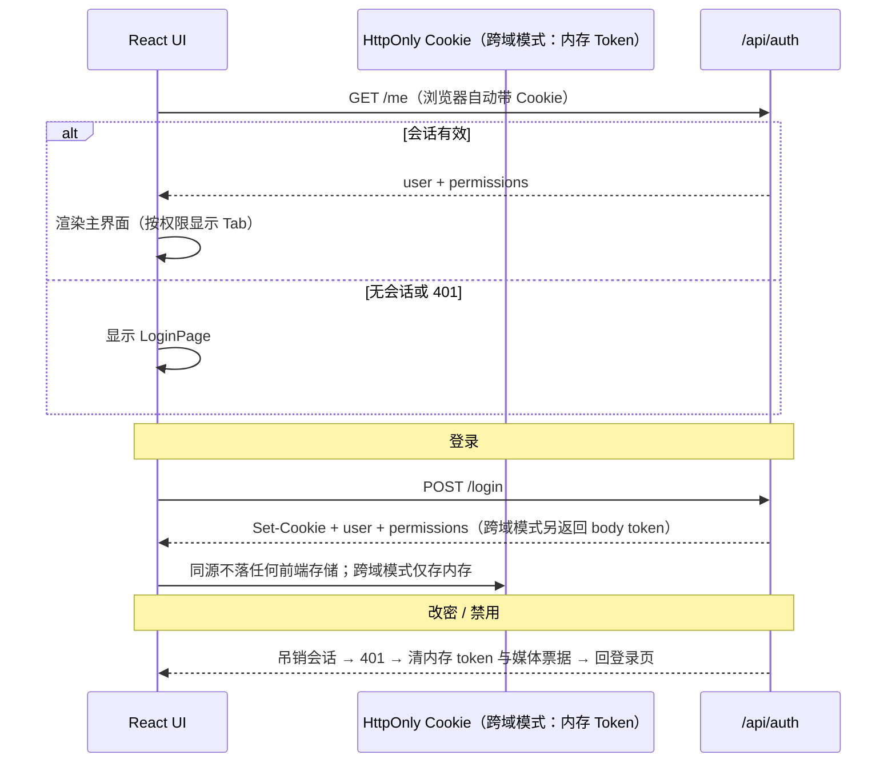

# Project-X 账号管理系统技术架构与版本说明

> **性质**: 账号与权限体系的全栈说明（v1.1~v1.5 成文，2026-10-17 按 v2.7.1 代码校订现行事实）
> **关联文档**: [`README.md`](./README.md)（readus 索引）· [`ACCOUNT-CONTROL.md`](./ACCOUNT-CONTROL.md)（后端 API 详述）· [`ARCHITECTURE.md`](./ARCHITECTURE.md)（系统总览）· [`ADMIN-GUIDE.md`](./ADMIN-GUIDE.md)（管理员手册）

> **校订说明**：第 4 节「v1.1 账号系统 vs 早期 main」是**历史对比**，保留原文不改；第 1、2、3、5、6 节描述当前实现，2026-10-17 逐项对照代码更正了会话有效期、强制鉴权默认值、教师权限表述、前端目录结构与构建命令。前端组件与样式分层的细节仍以 [ARCHITECTURE.md](./ARCHITECTURE.md) 与 [UI-ARCHITECTURE.md](./UI-ARCHITECTURE.md) 为准。

本文档从**全栈视角**说明 Project-X 三级账号控制系统（RBAC）的技术架构，并对比 **v1.1 账号系统** 与 **早期 main 分支（v1.0）** 的差异。

v1.3.0 没有改变账号角色模型本身；本次主要变更在答题卡模板、题级评分规则和考试/答题卡删除保护。账号体系仍负责限制谁能进入设计、阅卷、分析和账号管理入口。

---

## 1. 架构总览

v1.1 将原先「后端半就绪、前端完全开放」的认证体系，补全为 **后端 RBAC + Electron/React 登录门禁 + 角色化 UI** 的贯通方案。

```mermaid
flowchart TB
    subgraph Electron["Electron 桌面壳"]
        BW[BrowserWindow]
    end

    subgraph Client["React 前端 client/"]
        LP[LoginPage]
        AC[AuthContext + 内存 Token / HttpOnly Cookie]
        AM[AccountManagement]
        TM[TeacherManagement]
        SM[ClassManagement]
        SS[StudentScores]
        APP[App.tsx 角色化模式切换]
    end

    subgraph Server["Express 后端 server/"]
        MW[authMiddleware / optionalAuth / requirePermission]
        AUTH[/api/auth]
        USERS[/api/users]
        CLASSES[/api/classes]
        SCORES[/api/scores]
        GATE[业务路由 RBAC 网关]
    end

    subgraph Storage["本地存储"]
        DB[(projectx.db)]
    end

    BW --> APP
    LP --> AC
    AC -->|同源 Cookie / 跨域 Bearer| AUTH
    AC --> UM & CM & SS & APP
    APP --> GATE
    UM --> USERS
    CM --> CLASSES
    SS --> SCORES
    AUTH & USERS & CLASSES & SCORES & GATE --> MW
    MW --> DB
```

**数据流要点：**

1. 用户打开应用 → 前端调用 `GET /api/auth/me` 恢复会话：同源部署下浏览器自动带上 HttpOnly Cookie
   `projectx_auth_token`，前端**不**从 `localStorage` 读登录令牌（`AuthContext` 里的 `localStorage` 只存
   身份切换/教师角色覆盖这类界面偏好）。
2. 未登录（`/me` 401）则展示 `LoginPage`；登录成功后服务端 `Set-Cookie` 下发会话，请求凭据按模式分流：
   同源请求靠 Cookie，**只有跨域 API 模式**（`VITE_PROJECTX_API_BASE` 指向远端）才把 token 取到内存并
   附加 `Authorization: Bearer <token>`——内存态，绝不落 `localStorage`（`client/auth/api.ts`）。
3. 管理员通过「账号」模式操作 `/api/users` 与 `/api/classes`；学生通过「我的成绩」访问 `/api/scores/me`。
4. 业务接口（答题卡、考试、阅卷、分析）经兼容门 `makeGate` / `requirePermissionCompat` 判定：默认（`PROJECTX_AUTH_ENFORCE` 未设置）**即强制**，只有显式 `0` / `false` 才允许匿名通过；管理类接口**始终强制鉴权**（见 §2.2）。

---

## 2. 后端架构（共享服务层）

后端实现详见 [`ACCOUNT-CONTROL.md`](./ACCOUNT-CONTROL.md)，此处概括核心分层。

| 层级 | 路径 | 职责 |
|------|------|------|
| **权限模型** | `src/server/auth/permissions.ts` | 权限常量（`域:动作`）、`ROLE_IDS` / `ROLE_NAMES` / `TEACHER_ROLES`、`DEFAULT_ROLE_PERMISSIONS` 兜底表、`permissionSetGrants()` 通配判定、启动时从 `roles.permissions` 载入的进程内缓存 |
| **认证服务** | `src/server/services/AuthService.ts` | 登录、登出、改密、Token 签发与吊销。短时令牌 **8 小时**（`TOKEN_EXPIRE_MS`），勾选保持登录的持久令牌 **30 天**（`PERSISTENT_TOKEN_EXPIRE_MS`，安全审计 F-12-7 由 6 个月收敛而来）；令牌只存 SHA-256 哈希（P2-1 / M-S3） |
| **单次资源票据** | `src/server/services/mediaTicket.ts` | `POST /api/auth/media-ticket` 换 `?mt=`，给图片 / PDF / SSE 这类带不了请求头的 GET 用（安全 R30） |
| **中间件** | `src/server/middleware/auth.ts` | `authMiddleware`、`optionalAuth`、`requireRole`、`requirePermission`、`requirePasswordChangeCompleted` |
| **业务侧兼容门** | `src/apps/answer-card/server/middleware.ts` | `makeGate`、`requirePermissionCompat`、`requireExamAccess`、`hasViewPermission`（教师权限矩阵）——无身份时按 `PROJECTX_AUTH_ENFORCE` 决定放行还是 401，避免免登录的旧部署被 `requirePermission` 一律挡死 |
| **数据访问** | `UserRepository` / `ClassRepository` / `ScoreRepository` | 用户、组织结构、成绩查询 |
| **路由** | `routes/auth.ts` · `users.ts` · `classes.ts` · `scores.ts` · `admin-permissions.ts` | REST API；`admin-permissions.ts` 管的是**教师权限矩阵** `teacher_permissions` 行（按人/学科/班级/题块收放五个开关），**不是**角色权限位编辑器，见 §2.1 |
| **网关** | `apps/answer-card/server/index.ts` | 业务路由读写权限守卫；`optionalAuth` 记录 `created_by` |

### 2.1 三级角色与权限

| 角色 | `role_id` | 默认权限（`DEFAULT_ROLE_PERMISSIONS`） | 能力摘要 |
|------|---------|----------------------------------------|----------|
| **admin** | 1 | `["*"]` | 全部功能；`user:manage` / `class:manage` / `system:manage` 默认只有它持有 |
| **teacher** | 2 | `card:read` `card:write` `exam:read` `exam:write` `grade:read` `grade:write` | 答题卡设计、考试管理、阅卷、成绩分析 |
| **student** | 3 | `score:read` | 只看自己的成绩：我的成绩、已公布且本人参加考试的天梯、教师开启且成绩公布后的原卷/逐题答案、本人的 AI 成绩分析 |

三个容易被误读的口径：

- **默认表只是兜底，真正判定读数据库。** `initPermissionCache()` 启动时把 `roles.permissions`（JSON 列）载入进程内缓存，`roleHasPermission()` 查的是这份缓存；该列为空时才回落到 `DEFAULT_ROLE_PERMISSIONS`。这三个角色位由建库脚本播种，**当前没有改角色权限位的管理界面或 API**；`/api/admin/permissions`（整条 `requirePermission(USER_MANAGE)`，教师改不了）管的是教师权限矩阵 `teacher_permissions` 行，即「按人收口」，不是「改角色」。
- **教师默认权限是逐条列举的，不是 `card:*` 这类域通配。** 通配能力确实存在（`permissionSetGrants()` 认 `*` 与 `域:*`，管理员可以给任意角色写 `grade:*`），但默认表里没有，按默认表推断能力时必须逐条看。
- **教师细分角色改的是数据范围，不是权限位。** `teacher_role` 取 `subject_teacher`（学科老师）/ `head_teacher`（班主任）/ `grade_leader`（学年主任）（`TEACHER_ROLES`，迁移 v52 建列、v55 回填）。可见考试、可见班级、能阅哪些题块由 `getVisibleExamIds()` 与 `teacher_permissions` 矩阵（`hasViewPermission()`）决定，详见 [`ACCOUNT-CONTROL.md`](./ACCOUNT-CONTROL.md)。

### 2.2 渐进启用开关

| `PROJECTX_AUTH_ENFORCE` | 行为 |
|-------------------------|------|
| **未设置 / 其它任何取值（默认）** | **开启强制鉴权**：受保护路由未登录 401、权限不足 403 |
| `0` 或 `false`（大小写敏感） | 兼容模式：仍解析身份，但无 Token 也放行（单机 / 旧部署）。有身份时权限门照常判定 |

判定唯一真源是 `src/server/lib/authEnforce.ts` 的 `isAuthEnforced()`，**每次调用实时读 env**，不做进程启动快照。

> ⚠️ 本文早期版本把默认值写成「未设置=不拦截」，方向是反的。AGENTS.md 记录过这个 bug 的来历：`server/index.ts` 的 createApp 与 `middleware/auth.ts` 曾各有一份语义相反的判定，现已收敛成同一个函数。

### 2.3 学生账号在网页端的边界（#322）

issue #322「移除学生账号在网页端修改阅卷设置和上传背景图的能力」的现行口径。约束全部落在后端，前端只是不再把控件摆出来（AGENTS.md：隐藏按钮不等于授权校验）。

| 能力 | 学生 | 教师 / 管理员 | 强制点 |
|------|------|---------------|--------|
| 账号设置页「阅卷设置」页签（成绩指标显示、复核置信度阈值） | **不可见、不可写** | 可用 | `PATCH /api/users/me/settings`：请求体含 `scoreDisplayMode` / `reviewConfidenceThreshold` 且 `!roleHasPermission(role_id, grade:write)` → **整单 403**（`canWriteGradingSelfSettings()`）。不带这两项时，皮肤 / 明暗 / Tab 栏仍可写 |
| 背景图显示与透明度 | **不显示、不可写** | 可用 | 学生身份（`isStudentAccount()`），不看 `grade:write`。`GET` 设置把 `backgroundOpacity` 改写成 0；`GET /api/app/background` 返回 404（自定义图和默认图都不下发）；PATCH 带 `backgroundOpacity` 则整单 403。库里的历史值和 `backgrounds/<userId>.jpg` 保留，只是不再发给学生 |
| 上传自定义背景图 | **不可用** | 可用 | `POST /api/users/me/background` 在 multer **之前**挂 `requireBackgroundUploadAccess()`，学生直接 403，不产生落盘文件 |
| 皮肤、明暗、底部 Tab 栏 | 可用 | 可用 | 同一 PATCH 接口里、且请求没有夹带上面被禁字段时 |
| 本人 AI 服务商增删改 | 可用 | 可用 | `routes/ai-providers.ts` 按 `user_id` 归属自身行，密钥加密存储；不是跨用户写权限 |
| 网页端模式 | 只有 `scores` 与 `account-settings` | 全部 | `src/shared/appVariant.ts` 的 `allowedModes` + `App.tsx` 路由收敛 |

---

## 3. 前端 / Electron UI 架构（v1.1 新增）

### 3.1 目录结构

```
src/apps/answer-card/client/
├── auth/
│   ├── api.ts           # fetchJson / authFetch / urlWithToken / 401 自动登出
│   ├── AuthContext.tsx  # 全局认证状态、hasPermission、角色判断
│   └── types.ts         # 前后端 DTO、权限常量、permissionGrants()
├── components/
│   ├── LoginPage.tsx           # 登录页
│   ├── AccountMenu.tsx         # 右上角用户菜单（改密、退出）
│   ├── AccountManagement.tsx   # 管理员双 Tab 容器
│   ├── TeacherManagement.tsx   # 教师管理（科目/班级关联）
│   ├── ClassManagement.tsx     # 学生管理（年级/班级/花名册，原名班级管理）
│   └── StudentScores.tsx       # 学生自助查分
├── App.tsx              # 主壳：登录门禁 + 角色化模式 Tab
├── main.tsx             # AuthProvider 包裹根组件
└── styles.css           # 登录页、账号管理、成绩卡片样式
```

### 3.2 认证状态管理



**关键实现：**

- 会话凭据：服务端 `~/.projectx/tokens.json` 存 **SHA-256 哈希**后的 token，普通会话 8 小时、
  `isPersistent`（登录体里的持久标记，对应 Cookie `maxAge`）30 天；前端不持有可持久化的登录令牌副本。
- `fetchJson` / `authFetch` 统一带 `credentials: "include"`；仅 `isCrossOriginApiMode()` 时注入
  `Authorization` 头；错误体里的 `{ message }` 统一解析。
- `` / `<a>` / `EventSource` 这类**无法设请求头**的场景：同源直接依赖 Cookie；跨域优先用
  `POST /api/auth/media-ticket` 换出的单次 `?mt=` 票据，未命中缓存时才临时回落 `?token=`
  （`urlWithToken()` / `mediaUrl()` / `resignMediaTicketUrl()`，后端用媒体白名单限制 `?token=` 的可用路径）。
- 收到 401（除登录接口外）时触发 `projectx:unauthorized` 事件，清内存 token 与票据缓存并回到登录页。

### 3.3 工作模式与权限映射

`App.tsx` 在 v1.0 三种模式基础上扩展为五种，**按权限动态显示**：

| 模式 | 显示条件 | 主要组件 |
|------|----------|----------|
| **设计** | `card:read` | 答题卡编辑器、预览、PDF 导出 |
| **阅卷** | `grade:read` | 图片上传、扫描仪、判分结果 |
| **分析** | `exam:read` | 成绩统计、排名、题目分析；子 Tab「考试管理」需 `exam:write` |
| **我的成绩** | 学生角色 + `score:read` | `StudentScores` |
| **账号** | `user:manage` | `AccountManagement`（教师管理 + 学生管理） |

**布局差异：**

- 教师/管理员：左侧答题卡列表 + 右侧工作区。
- 学生：无左侧栏（`no-card-sidebar`），全宽展示「我的成绩」。

### 3.4 与 Electron 的集成方式

Electron 主进程（`electron/main.cjs`）启动内嵌 Express 服务并加载 `dist/client` 静态资源。账号 UI **不修改 Electron 主进程**——认证完全在前端 SPA 层完成，通过同源 HTTP 调用本地 API。

生产环境数据目录：`%AppData%/.../userData/data/projectx.db`（用户与成绩数据与桌面安装位置无关，便于机房统一部署）。

---

## 4. v1.1 账号系统 vs 早期 main（v1.0）对比

早期 main 分支对应 README 标注的 **v1.0.0**：答题卡设计 → 阅卷 → 分析全流程可用，但**产品层未启用账号体系**。

### 4.1 功能对比

| 维度 | 早期 main（v1.0） | 账号系统（v1.1 起） |
|------|-------------------|------------------|
| **启动体验** | 打开即用，无需登录 | 必须先登录；会话过期自动回登录页 |
| **前端模式** | 设计 / 阅卷 / 分析（人人相同） | 按角色显示不同 Tab；学生仅「我的成绩」 |
| **用户管理 UI** | 无 | 管理员「账号」页：增删改查、批量导入、重置密码 |
| **班级管理 UI** | 无 | 年级 → 班级 → 花名册三栏管理 |
| **学生查分 UI** | 无 | 学生登录后查看各场考试得分、排名、逐题明细 |
| **改密** | 无 UI（仅有后端潜力） | 右上角用户菜单自助改密 |
| **API 鉴权** | 业务接口完全开放 | 管理 API 强制鉴权；业务 API 可选 `PROJECTX_AUTH_ENFORCE` |
| **Token 传递** | 前端不传 Token | 全站 `fetchJson` + PDF/SSE `?token=` |
| **班级筛选分析** | 分析页可读班级（若后端有数据） | 同上，且班级需管理员先建班编班 |
| **自动化验证** | 无 | `npm run verify:auth`（33 项用例） |

### 4.2 代码变更范围

**v1.0 → v1.1 后端新增/修改**（见 `ACCOUNT-CONTROL.md` 第 2 节）：

- 新增：`permissions.ts`、`ClassRepository`、`ScoreRepository`、`routes/users|classes|scores`、`verify-auth.ts`
- 修改：`AuthService`、`UserRepository`、`middleware/auth`、`routes/auth`、`server/index.ts`

**v1.1.0 新增多端变体**：

| 变体 | ID | 默认首页 | 允许模式 | 原生资源 |
|------|------|------|------|------|
| 学生端 | `student` | 我的成绩 | `scores` | 无 |
| 教师普通端 | `teacher` | 设计 | design/grading/analysis/account | 识别引擎 |
| 教师扫描端 | `teacher-scanner` | 阅卷 | design/grading/analysis/account | 全部（识别+扫描） |

- 三端共用 `%APPDATA%\answer-card-designer` 数据目录
- 变体配置：`src/shared/appVariant.ts`（v1.6.1 起由 `VITE_BUILD_TARGET` 替代编译时变体）
- 扫描端打包：`npm run electron:dist` / `electron:msi`（仅扫描端，x64/ia32）
- 学生端既限产品功能（只能看我的成绩），也限账号角色权限
- 新增：`passwordPolicy.ts`（学生默认密码允许5位学号）

**v1.1 前端新增**（相对 v1.0 的 `client/`）：

| 新增文件 | 说明 |
|----------|------|
| `auth/api.ts` | 鉴权 HTTP 封装 |
| `auth/AuthContext.tsx` | React Context |
| `auth/types.ts` | 类型与权限工具 |
| `components/LoginPage.tsx` | 登录页 |
| `components/AccountMenu.tsx` | 用户菜单 |
| `components/AccountManagement.tsx` | 账号管理容器 |
| `components/TeacherManagement.tsx` | 教师管理 |
| `components/ClassManagement.tsx` | 学生管理（原班级管理改名） |
| `components/StudentScores.tsx` | 学生成绩 |

| 修改文件 | 说明 |
|----------|------|
| `App.tsx` | 登录门禁、五种模式、权限 Tab、`urlWithToken` 链接 |
| `main.tsx` | 挂载 `AuthProvider` |
| `styles.css` | 账号/登录/成绩样式 |
| `ScannerPanel.tsx` | 扫描 API 与 SSE 鉴权 |

### 4.3 数据库与部署

| 项目 | v1.0 | v1.1 |
|------|------|------|
| **Schema 迁移** | — | **无需迁移**，复用已有 `users/roles/grades/classes/...` 表 |
| **默认账号** | 库中有 admin，但 UI 不强制使用 | 首次登录 `admin` + 数据库同目录的一次性引导密码，系统强制立即改密 |
| **向后兼容** | — | `PROJECTX_AUTH_ENFORCE=0` 时旧版「无 Token 调业务 API」仍可工作（管理 API 除外） |

### 4.4 架构演进示意

```
v1.0 main
  Electron → React（三模式，无登录）→ Express（业务 API 开放）
                    ↘ Auth 骨架存在但未贯通

v1.1 当前
  Electron → React（登录 + 角色化 UI）→ Express（RBAC + 管理 API）
                    ↘ Token 全链路 · 可选业务强制鉴权
```

---

## 5. 安全与设计取舍

| 议题 | 当前方案 | 说明 |
|------|----------|------|
| Token 存储 | 磁盘文件 `~/.projectx/tokens.json`（只存 SHA-256 哈希） | 服务器重启后会话存活；普通 8 小时、持久会话 30 天 |
| 前端 Token | 同源不落任何存储（HttpOnly Cookie），跨域模式仅内存 | 避免 XSS 拿到长期令牌；改密/禁用时服务端吊销 |
| 密码 | bcryptjs 哈希（bcrypt 格式兼容） | 默认学生密码=学号，管理员应督促首次登录改密 |
| 管理员保护 | 至少保留 1 名 admin | 后端拒绝降级/禁用最后一名管理员 |
| 排名计算 | 查询时即时计算 | 不依赖 `student_scores.rank` 是否落库 |

---

## 6. 验证与构建

```powershell
npm install
npm run typecheck      # TypeScript 严格模式
npm run verify:auth    # 后端 RBAC 端到端（临时库，33 项）
npm run build
npm run electron:dev   # 桌面应用联调
npm run electron:msi:all # 生成三端 x64/ia32 共 6 个 MSI
```

启用完整业务鉴权：

```powershell
$env:PROJECTX_AUTH_ENFORCE = "1"
npm run electron:dev
```

---

## 7. 文档索引

| 文档 | 读者 | 内容 |
|------|------|------|
| **本文** | 开发者 | 全栈架构 + v1.0/v1.1 对比 |
| [`ACCOUNT-CONTROL.md`](./ACCOUNT-CONTROL.md) | 开发者 | 后端 API、权限模型、接口清单 |
| [`ADMIN-GUIDE.md`](./ADMIN-GUIDE.md) | 学校管理员 | 操作步骤与日常流程 |
| [`ARCHITECTURE.md`](./ARCHITECTURE.md) | 开发者 | 答题卡系统总体架构 |
| [`DATABASE.md`](./DATABASE.md) | 开发者 | 数据库表结构 |

---

_由五中人，为五中人，服务五中教学。_
