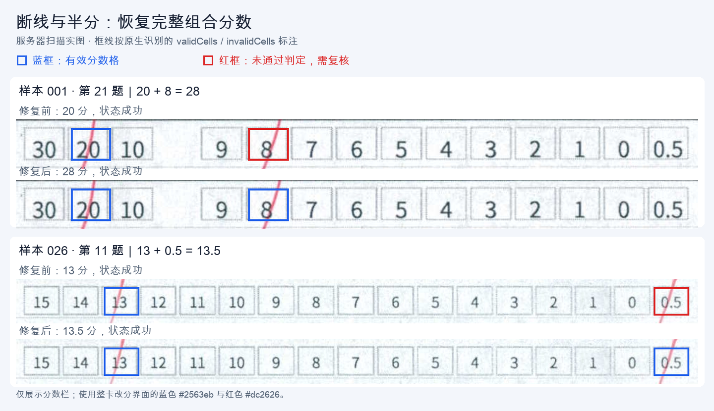
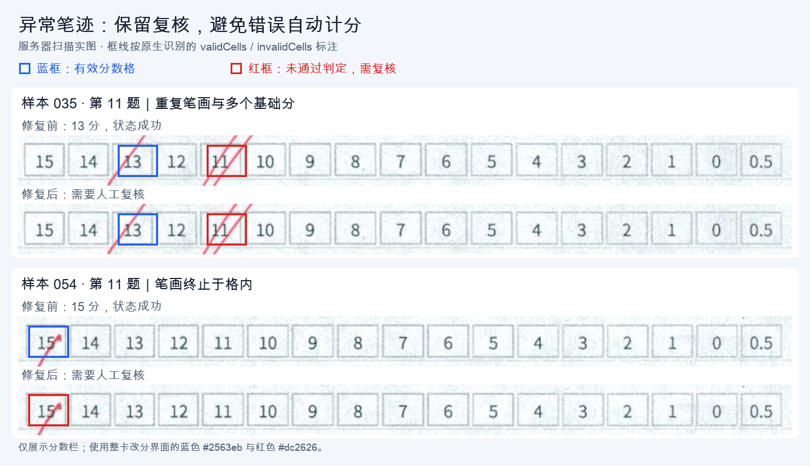

# 主观题红笔划线识别修复记录

日期：2026-10-17。分支：`codex/fix-subjective-red-line-recognition`，基于 `origin/main` 的 `ec5b411`。

## 实图调查

从当前服务器下载了答题卡 `58409494` 的全部 69 张相关扫描图片及布局，共 138 道主观题。69 张图片的 SHA-256 均不同。原图、存量识别结果、逐格指标、人工核对表及运行日志保存在本地 `ignored/red-line-investigation/`。

先逐张查看校正后的分数栏，再放大核对边缘、短线和重复笔画。最终人工对照包含 96 道有效分数、42 道需要复核的异常笔迹。有效的零分按 0 分处理，空白、黑笔、涂抹、多选、重复笔画及未充分跨格的短线进入复核。

存量结果中有 7 道与主线原算法重新识别的分数或状态不同，因此对照分数以图片核对为准。放大复核时，样本 019 第 21 题确认是有效的 30 分直线；样本 054 第 11 题则终止于格内，保留复核标记。

## 原因与修改

识别入口是 `answer_recognition.cpp` 的 `sample_score_cell`，结果经 `build_subjective_questions` 组合计分，再由共享判分函数 `gradeSubjectiveRecognition` 生成 `needsReview`，供扫描端成绩和复核流程消费。

1. 固定的 3×3 开运算会抹掉细笔画，印刷数字又会把红色像素切成数段。原算法要求只有一个红色连通区域，导致一条有效划线被拒识。现在按像素数量过滤细碎噪点，保留细线与断开的笔画，结合整体直线、投影覆盖率和断口大小判定。
2. 150 DPI JPEG 中的细笔画饱和度会下降。红色饱和度下限由 55 调整为 35，仍保留色相和亮度约束。
3. 原线长统一除以格子对角线，竖直线容易被判为过短。现在按笔画方向计算跨格长度，并检查拟合直线与格子相交路径的两端，拒绝只覆盖格子一侧的笔迹。
4. 组合计分会忽略已经检出但未通过判定的红色笔迹，出现「20＋8」只给 20 分且状态成功的问题。现在存在未确认笔迹时，整道题进入复核，避免只保存部分组合分数。重复平行笔画、叉形、过大的断口和非法分数组合均保留复核。

实际样例：

| 匿名样本 / 题号 | 卡面结果 | 原算法回放 | 修复后 |
| --- | --- | --- | --- |
| 001 / 21 | 20＋8＝28 | 20，成功 | 28，成功 |
| 007 / 21 | 20＋4＝24 | 4，成功 | 24，成功 |
| 026 / 11 | 13＋0.5＝13.5 | 13，成功 | 13.5，成功 |
| 035 / 11 | 多个基础分及重复笔画 | 13，成功 | 复核 |
| 054 / 11 | 终止于格内的短笔画 | 15，成功 | 复核 |

## 验证结果

本组实图的人工对照结果：

| 指标 | 原算法回放 | 最终算法 |
| --- | --- | --- |
| 有效分数识别正确 | 56 / 96 | 96 / 96 |
| 异常笔迹正确进入复核 | 31 / 42 | 42 / 42 |
| 错误自动计分 | 23 | 0 |
| 有效分数被要求复核 | 28 | 0 |
| 分数与复核状态均符合人工对照 | 87 / 138 | 138 / 138 |

- Windows 11 ARM64 实际运行 ia32 原生识别器，完成 69 张原图的完整识别回放；补充两端覆盖判定后，对同批无损校正分数格再次进行最终原生逐格回放，共 138 道全部符合人工对照。最终 CLI 也重新识别原始样本 001，严格身份校验通过，得到 14 分和 28 分。
- Linux x64 原生识别器使用现有 OpenCV 4.13 缓存交叉编译，在 Ubuntu ARM64 中通过 x64 加载器及架构模拟运行原始样本 001，严格身份校验通过，得到相同的 14 分和 28 分。
- `npm run verify:recognizer-red-line`：初次验证的输入为 150 / 300 DPI JPEG，但两组均请求 300 DPI 输出；审核指出此处未覆盖实际 150 DPI 路径。审核修正后的 18 个场景分别按实际 150 / 300 DPI 执行，共 36 个识别和共享判分断言场景，并断言输出 DPI 和像素尺寸。覆盖数字遮挡、极细线、横线、零分、半分、空白、黑笔、短线、单侧笔迹、擦边笔迹、叉形、重复平行线、分离噪点、多选及超满分。原识别器在同一回归的断线场景稳定复现 28 分被计成 20 分。
- `npm run build:scanner:full`：类型检查、扫描端和服务端构建通过。
- `npx tsx scripts/grading-rules-smoke.ts`：通过。新增测试脚本单独执行 TypeScript 检查通过；`git diff --check` 通过。

新增回归使用合成卡，无需访问服务器。先编译对应架构的原生识别器，设置 `ANSWER_CARD_RECOGNIZER_EXE` 指向新编译的可执行文件，再执行 `npm run verify:recognizer-red-line`。

## 随包原生识别器

Windows ia32、Windows x64、Linux x64 三个识别器均已重新编译并更新到 `resources/native/` 的对应目录，打包时直接使用这些资源。每个目录附带 `source-sha256.txt`，已逐项核对当前源码。Windows 资源补齐静态依赖的许可证材料；OpenCV 与 C++ 运行库静态链接。

| 目标 | 二进制 SHA-256 |
| --- | --- |
| Windows ia32 | `350b8e56263f8f7449b79e5e09a248947b64f9438df8e919f5ca27e5aac66b5e` |
| Windows x64 | `0e2345aa9eca1a95bd4c30380be7f0a4eac820ac3c2051ff8cee167ac0992978` |
| Linux x64 补识别 | `20aa637f02078207650cc980d2862068178e1d29f55881c2f6f800ae7253d771` |

Windows 使用 MinGW-w64 GCC 16.2.0、OpenCV 4.13.0，分别通过 `npm run native:build:mingw:ia32` 和 `npm run native:build:mingw:x64` 构建。构建脚本默认 ia32，两个目标使用各自的缓存、工具链、TWAIN DSM 和 PE 架构校验，保留 QR 解码链接检查，并在去除符号后输出源码清单。

审核修正后，最终资源中的 Windows 两个识别器各通过 36 个实际 150 / 300 DPI 合成识别与判分场景。Windows 11 ARM64 中分别直接运行这两个资源文件，对样本 001、026、035、054 共执行 8 次完整原图识别：组合分数、半分、异常复核及严格身份校验均符合预期；运行文件的 SHA-256 与提交资源一致。Linux x64 进行了干净重编译，原始样本 001 严格身份校验通过，结果为 14 分和 28 分；同组 36 个实际 DPI 合成场景在 Ubuntu ARM64 的 x64 架构模拟环境中也全部通过，输出 DPI 和尺寸、身份、分数及复核状态均核对一致。扫描端与服务端构建再次通过。

## 审核修正：实际 150 DPI 与 CI

审核指出回归脚本把两种输入图都按 300 DPI 输出。本机将调用改为循环中的 `dpi` 后，原随包识别器在 150 DPI 的细线场景稳定失败：一个分数格的 `crossingRatio=0.6699`、`endGapRatio=0.2679`，导致原本有效的 28 分进入复核。该意见属实。

拟合投影使用像素中心，低分辨率下端点像素的覆盖范围会明显影响长度和两端间隙。修正时将端点像素沿拟合方向的覆盖计入判定，补偿长度限制在直线穿过格子的实际路径内；保留 0.70 的跨格阈值和 0.25 的单端间隙阈值。补充擦边笔迹负例，避免只掠过格子边角的划线被补偿成有效分数。

脚本现在传入实际 DPI，并检查原生返回的 `output.dpi`、`widthPx`、`heightPx`。CI 新增独立步骤，使用 `resources/native/correction-linux-x64/answer-card-recognizer` 执行该回归，覆盖每个 DPI 下的 18 个原生识别和共享判分场景。

同批 69 张测试卡的无损校正分数格重新回放，138 道题的有效分数与复核状态均符合原人工对照；其中样本 048 的擦边划线和样本 054 的格内短线继续进入复核。

## 红蓝框测试图

图中只展示扫描图片的分数栏；矩形使用布局中的真实分数格坐标，蓝框对应原生结果的 `validCells`，红框对应 `invalidCells`。颜色复用整卡改分界面的 `#2563eb` 与 `#dc2626`。

