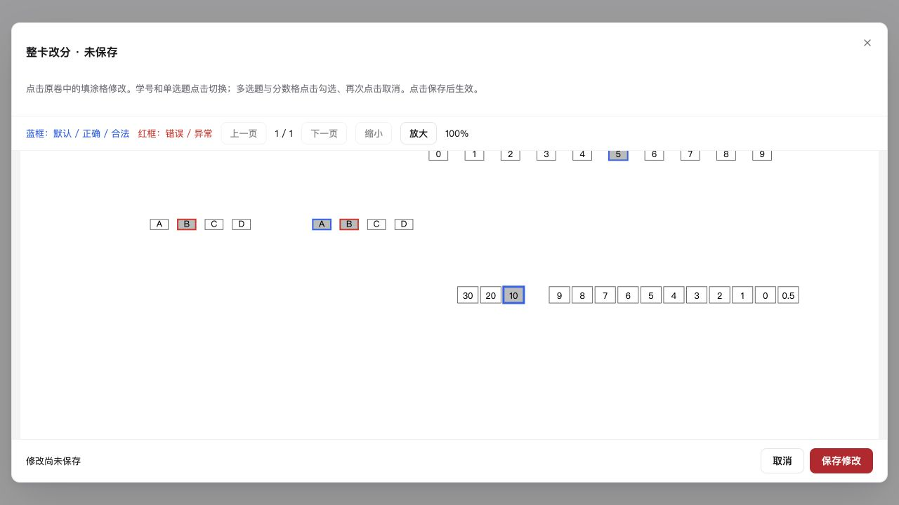
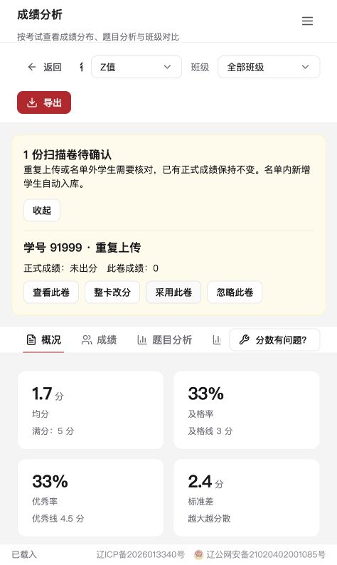
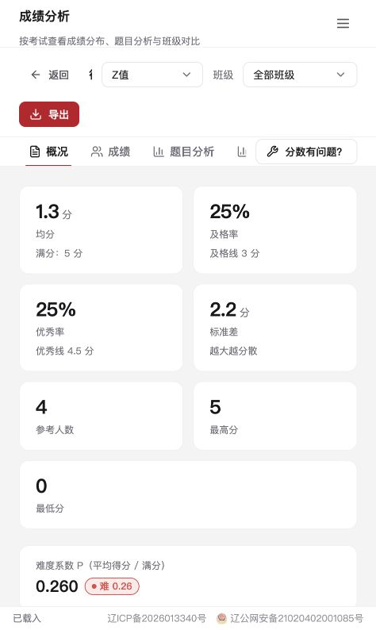

# 整卡改分

整卡编辑使用扫描原图显示学号、客观题选项和纸面手阅分数格。入口位于「成绩修改 → 个别改分」的「整卡改分」按钮，以及扫描失败卷、重复卷、未保存卷和上传失败结果中。

上图为合成样卷的交互预览：错误选项显示红框，正确选项和合法分数显示蓝框，点击后处于未保存状态。

- 蓝框表示正常学号、客观题正确选项及合法分数格；红框表示错误选项、学号多选和非法分数格。
- 学号每位点击切换且保持必选；单选题点击切换，再次点击已选项可清空为空答；多选题及分数格点击选择，再次点击取消。
- 十位、个位、小数位分别校验，同一位重复选择只标红该位；分数组合超满分时标红组合。
- 原识别为不合法笔迹的分数格可以取消后重新选择，表示人工确认。
- 点击仅改变草稿。保存按钮才提交，取消或关闭会提示放弃未保存修改；不同页面的修改一起提交。
- 已入库成绩按改动题目更新、重算总分和排名，并沿用考试公布策略。未修改的题目、网阅会话、分配和批注不重写。扫描再次汇总保留改分结果。
- 主观题订正按答题卡定义中的题号和满分写入，正式成绩与撤出成绩快照使用同一判分规则，避免扫描元数据中的题号不一致导致串题。
- 异常卷保存时沿用二维码、完整页序、名单和重复卷检查，只请求当前卷入库；其他待保存卷保持待保存。仍有重复卷等问题时订正保留，待异常解决后入库。
- 已入库卷的学号不能直接改为另一名学生；学号归属订正走异常卷处理，避免覆盖另一人的成绩或移动网阅记录。

## 坐标与兼容

原生识别结果新增 `geometry`：原图像素宽高，以及按行存储的 3×3 `imageToLayout`、`layoutToImage` 矩阵。排版坐标单位是毫米，图像坐标指原始扫描图，矩阵已经包含识别时的 90° 倍数旋转。页面把填涂格四角投影成四边形，缩放和滚动同步作用于原图及覆盖框。

成绩改分只读取该学生最近成功批次的原卷，避免混入历史批次。删除单张扫描、扫描会话或考试，以及原卷过期清理时，会同步清理对应订正快照。

SQLite 迁移 62 和 MariaDB 初始化/升级增加 `scan_correction_pages`，保存识别结果与排版快照、版本和修改人。保存时检查页面版本，过期或被其他教师修改的草稿拒绝写入；多页写入在事务内完成。

服务器已有原图但缺少坐标变换的异常卷，可点击「重新识别旧卷」。Ubuntu x86_64 服务端调用 `resources/native/correction-linux-x64/answer-card-recognizer`，只补识别缺少数据的页；已有坐标的页直接沿用。普通扫描、上传、裁图和批阅继续使用原链路。

重新识别只返回草稿，不写识别表、不改成绩；点击「保存修改」才在事务中保存。保存同时核对服务端草稿签名、原图摘要、原识别记录、版式、二维码、页码和坐标尺寸；原卷或数据被替换后旧草稿不能覆盖新结果。识别按请求串行、单页超时 30 秒，临时布局处理后清理。服务端重启后，尚未保存的补识别草稿需重新识别。

学号缺填或多选导致识别失败时，只要定位、二维码和题目数据有效，仍可进入待订正草稿。每位学号订正为一个数字后才能保存；缺少坐标、二维码不符或其他识别失败不会生成可保存草稿。

原图摘要按文件流计算，图片尺寸只读取最多 512 KiB 的头部数据。上传原图和旧卷补识别前均检查像素预算，沿用 `PROJECTX_RECOGNIZER_MAX_IMAGE_PIXELS` 的原生档位：x64 默认 1 亿像素、上限 4 亿，ia32 默认 4000 万、上限 7000 万。超限上传返回 413，已存超限旧卷在调用识别器前拒绝处理。PNG、JPEG、BMP、TIFF 和 WebP 共用预检。

订正请求同时限制调用者、扫描会话和服务端并发；请求过多时返回 429，稍后可重试。客户端断开不会提前释放仍在工作的并发名额。

版本 2.7.0 的 Ubuntu 服务端包包含此 Linux x86_64 二进制及第三方许可，无需启用 `PROJECTX_ENABLE_SCANNER`。源码可在 Ubuntu 24.04 用 `bash scripts/build-recognizer-linux.sh` 重建；ARM64 构建机需要 `g++-x86-64-linux-gnu` 交叉编译器。SQLite 和 MariaDB 均使用 v62 增量迁移；SQLite → MariaDB 工具也会迁移订正快照，旧源库没有此表时跳过。

## 验证

- `npm run verify:scan-correction`：SQLite 隔离 API、单选/多选/分数规则、草稿隔离、过期版本、成绩与公布状态、扫描重放、冲突快照恢复、主观题号不一致以及学号缺填/多选的补识别订正。
- MariaDB 使用 `scripts/scanner-upload-flow-fixture.ts` 的独立空库约束，并执行同一测试；数据库名称必须以 `projectx_scanner_batch_` 开头。
- `npm run verify:scan-correction-security`：图片头部像素预算、格式兼容、超限上传和补识别预检，以及 64 MiB 原图的调用者/会话/全局并发限制、完整文件摘要、原图变更后的草稿失效、错误后的名额释放和请求速率限制。
- `npm run verify:recognizer-geometry`：在 Linux x86_64 环境运行包内识别器，或在 Windows 环境运行扫描端识别器；四种旋转的合成样卷验证中文路径、手阅分数、毫米/原图像素变换及逆变换，并验证学号缺填和多选的原生结果可进入草稿、订正后通过校验。Windows 可用 `ANSWER_CARD_RECOGNIZER_EXE` 指定新编译的识别器。
- 还需运行 `npm run verify:scanner-correction-safety`、上传管理器回归、权限安全回归、Web/服务端及扫描端构建。

合成样卷与虚拟机验证不代表实体扫描仪或真实考试答题卡的硬件验收。

## 已公布考试的扫描待确认

- 已公布或曾公布的考试收到冲突卷时，保留原正式成绩及公布状态。相同原图的已验证重传自动忽略；其他重复卷等待教师确认。
- 名单内没有成绩的学生正常自动入库。名单外学生先待确认，采用时校验有效学生账号、考试范围和教师班级权限，再加入名单。
- 对应考试详情和成绩分析显示待确认横幅，可查看原图、订正、采用或忽略。采用前再次展示原成绩与拟采用成绩；取消不会保存。
- 确认时重新校验原卷版本、正式成绩及权限，过期页面需要刷新。采用、赋分重算、排名、裁图绑定和审计记录在同一事务内完成；失败全部回滚。
- 自动撤回公布仍由系统配置控制，只在正式成绩实际变更时执行。批量判分的赋分失败也会回滚整批写入。
- 批量判分事务跟踪本次移动的切图。整批事务或单个学生保存点回滚时恢复对应输入文件，清理本次新增的空目录；失败后可以重试，已提交卷的切图保留。

### 前端模拟操作验证

使用隔离数据库和合成样卷，在浏览器实际完成登录、考试详情查看、取消确认、采用重复卷、切换成绩分析、无效账号拦截、忽略异常卷以及接纳权限范围内名单外学生。确认后人数从 3 更新为 4，均分从 1.7 更新为 1.3，待确认横幅消失。

`npm run verify:scanner-pending` 覆盖待确认、权限、过期确认、连续确认、自动撤回、赋分失败后的数据库与切图回滚、重复失败后重试、部分学生写入失败的文件恢复和缓存提交边界；MariaDB CI 使用独立空库执行同一测试。
